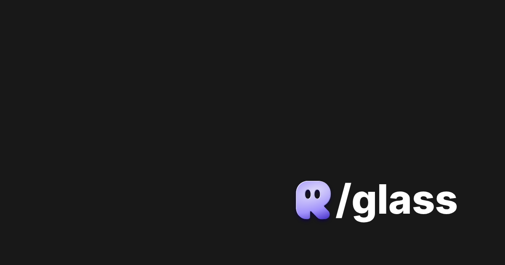

<div align="center">


# Reicon

### Beautiful, curated glass SVG icons for designers & developers.

**2,600+ icons** · **38 categories** · **3D glass shader** · crafted on a 24×24 grid.

<br/>

[](https://glass.reicon.dev)
[](https://github.com/dqev/reicon-glass)
[](LICENSE)

[**Browse icons →**](https://glass.reicon.dev) · [**LLM Spec →**](https://glass.reicon.dev/llms.txt)

</div>

<br/>

<div align="center">
  
</div>

<br/>

## Why Reicon

Every icon is designed for consistency, clarity, and balance on a standard 24×24 grid, rendered with a real-time 3D glass shader.

- **3D Glass Rendering:** real-time interactive glass shader with live accent color theming
- **Pixel-perfect:** built on a 24×24 grid for crisp rendering at any scale
- **Direct copy:** one-click copy for raw SVG, React JSX, and CSS snippets
- **Fast search:** keyboard-first command palette (**⌘K** / **/**)
- **100% Free & Open Source:** for personal and commercial use under MIT

<br/>

## Quick start

### 1. Direct SVG
Copy SVG markup directly from the web explorer:

```html
<svg width="24" height="24" viewBox="0 0 24 24" fill="currentColor">
  <!-- Icon path code -->
</svg>
```

### 2. React Component
```jsx
export function Icon({ size = 24, color = "currentColor", className = "", ...props }) {
  return (
    <svg width={size} height={size} viewBox="0 0 24 24" fill={color} className={className} {...props}>
      <!-- Icon path code -->
    </svg>
  );
}
```

<br/>

## Categories

2,600+ icons categorized across 38 domains:

- **UI & System:** UI, Settings, Tools, Text Formatting, Security, Folders, Files, Notes, Notifications
- **Navigation:** Arrows, Arrows Action, Map, List
- **Media & Tech:** Devices, Video, IT, Building, Call
- **Commerce & Work:** Business, Money, Shopping, School
- **Lifestyle & Nature:** Astronomy, Weather, Nature, Food, Sports, Medicine, Faces, Hands, Like, Time, Users, Parts, Astrology, New Icons

<br/>

## Development

```bash
# Install dependencies
npm install

# Start local dev server
npm run dev

# Build for production
npm run build

# Run linter
npm run lint
```

<br/>

## License

All icons and source code in this repository are released under the [MIT License](LICENSE). Free for personal and commercial use.

<div align="center">
<br/>

Made with care by [Reicon](https://glass.reicon.dev)

</div>